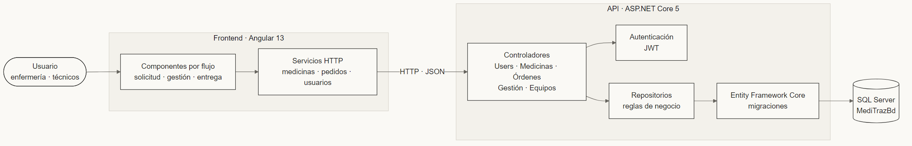
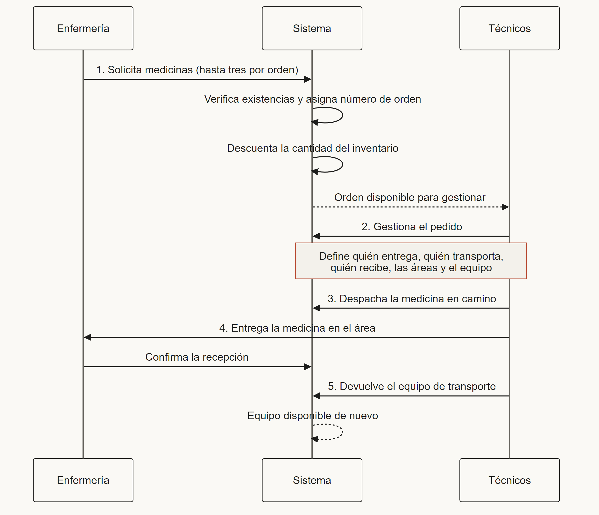
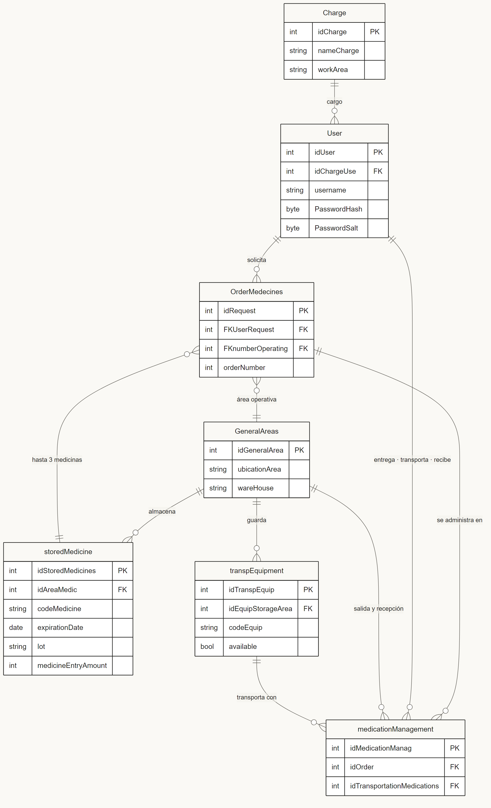
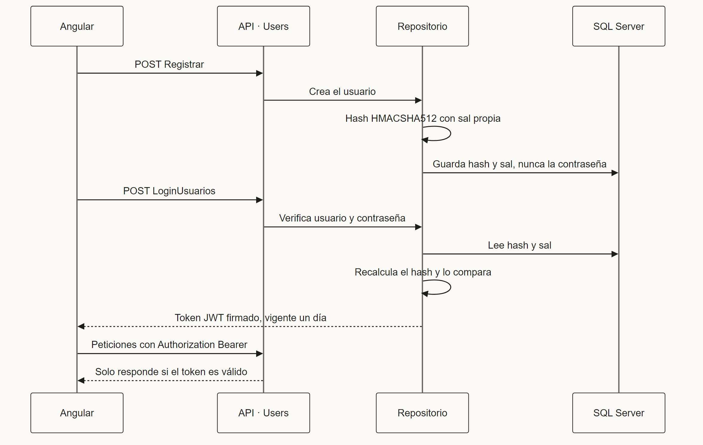
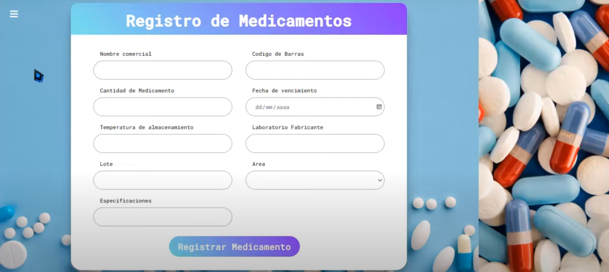
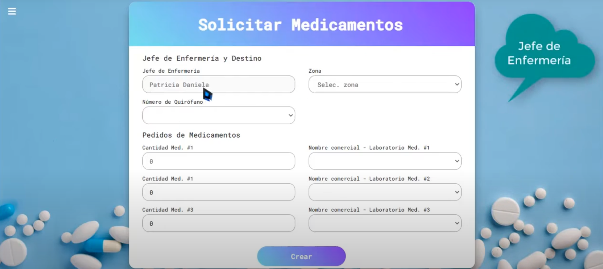

# Meditraz · Sistema de trazabilidad de medicamentos

Prototipo académico para registrar y rastrear medicamentos dentro de un entorno clínico: inventario con lote y fecha de vencimiento, solicitudes de medicinas, gestión del pedido, transporte con equipo asignado, entrega y devolución del equipo.

Se desarrolló en la Universidad Autónoma de Bucaramanga (UNAB) y se publicó como artículo de investigación (ver [Origen académico](#origen-académico)).


---

## Contenido

- [Qué hace](#qué-hace)
- [Arquitectura](#arquitectura)
- [Flujo de trazabilidad](#flujo-de-trazabilidad)
- [Modelo de datos](#modelo-de-datos)
- [Autenticación](#autenticación)
- [Endpoints](#endpoints)
- [Estructura del repositorio](#estructura-del-repositorio)
- [Cómo ejecutarlo](#cómo-ejecutarlo)
- [Capturas](#capturas)
- [Limitaciones conocidas](#limitaciones-conocidas)
- [Origen académico](#origen-académico)
- [Autores](#autores)

---

## Qué hace

- **Inventario de medicinas:** registro con código, nombre comercial, lote, laboratorio, temperatura, cantidad, fecha de ingreso y fecha de vencimiento, asociado a un área de almacenamiento.
- **Solicitudes de medicinas:** enfermería pide hasta tres medicinas por orden. El sistema verifica existencias, asigna un número de orden y descuenta la cantidad del inventario.
- **Gestión del pedido:** los técnicos definen quién entrega, quién transporta y quién recibe, las áreas de salida y recepción y el equipo de transporte.
- **Equipos de transporte:** registro y disponibilidad de los equipos que movilizan las medicinas.
- **Usuarios y cargos:** registro e inicio de sesión con contraseña protegida y token JWT; cada usuario tiene un cargo (enfermería o técnico).

---

## Arquitectura

Aplicación en tres capas: una SPA en Angular que consume una API REST en ASP.NET Core, respaldada por SQL Server mediante Entity Framework Core.



| Capa | Tecnología | Detalle |
| --- | --- | --- |
| Frontend | Angular 13, Angular Material, Bootstrap 5, RxJS | Un componente por paso del flujo y servicios HTTP por recurso |
| API | ASP.NET Core 5 | Controladores, patrón repositorio con interfaces, DTOs y AutoMapper |
| Acceso a datos | Entity Framework Core 5 | Modelos, `ApplicationDBContext` y migraciones |
| Base de datos | SQL Server | Script en `Base de datos/MediTrazBd.sql` |
| Documentación de la API | Swagger (Swashbuckle) | Disponible en desarrollo |

---

## Flujo de trazabilidad

El recorrido de una medicina tiene cinco pasos, cada uno con sus pantallas en el frontend.



| Paso | Qué ocurre | Quién |
| --- | --- | --- |
| 1. Solicitud | Se crea la orden, se valida el stock y se descuenta | Enfermería |
| 2. Gestión | Se asignan responsables, áreas y equipo | Técnicos |
| 3. Medicina en camino | Se despacha el pedido | Técnicos |
| 4. Entrega | Se entrega y se confirma la recepción | Técnicos y enfermería |
| 5. Devolución de equipo | El equipo vuelve a quedar disponible | Técnicos |

---

## Modelo de datos



| Entidad | Para qué sirve |
| --- | --- |
| `User` y `Charge` | Usuarios y su cargo |
| `GeneralAreas` | Áreas y bodegas del centro |
| `storedMedicine` | Medicinas almacenadas, con lote y vencimiento |
| `transpEquipment` | Equipos de transporte y su disponibilidad |
| `OrderMedecines` | Orden de solicitud con hasta tres medicinas |
| `medicationManagement` | Administración del pedido: responsables, áreas y equipo |

---

## Autenticación

- Las contraseñas **no se guardan**: se almacena un hash HMACSHA512 con una sal propia por usuario.
- Al iniciar sesión se recalcula el hash y, si coincide, la API entrega un **token JWT** que vence en un día.
- El frontend envía el token en la cabecera `Authorization: Bearer`. Las operaciones de medicinas, órdenes, gestión y equipos exigen un token válido.



---

## Endpoints

Prefijo común: `/api`

| Recurso | Método y ruta | Descripción |
| --- | --- | --- |
| **Users** | `GET /Users` | Lista los usuarios (requiere token) |
| | `GET /Users/getCargos` | Lista los cargos |
| | `POST /Users/Registrar` | Registra un usuario |
| | `POST /Users/LoginUsuarios` | Inicia sesión y devuelve el token |
| **storedMedicines** | `GET /storedMedicines/ObtenerMedicinas` | Lista las medicinas |
| | `GET /storedMedicines/ObtenerMedicinaUnitaria/{id}` | Consulta una medicina |
| | `POST /storedMedicines/RegistrarMedicamentos` | Registra una medicina |
| | `PUT /storedMedicines/ActualizarRegistro` | Actualiza un registro |
| **OrderMedecines** | `GET /OrderMedecines/ObtenerOrdenes` | Lista las órdenes |
| | `GET /OrderMedecines/ObtenerOrden/{id}` | Consulta una orden |
| | `POST /OrderMedecines/CrearNuevaOrden` | Crea una orden (valida el stock) |
| | `DELETE /OrderMedecines/BorrarOrden/{id}` | Elimina una orden |
| **medicationManagement** | `GET /medicationManagement/ObtenerPedidos` | Lista los pedidos administrados |
| | `GET /medicationManagement/ObtenerPedido/{id}` | Consulta un pedido |
| | `POST /medicationManagement/AdministrarPedido` | Administra un pedido |
| **transpEquipments** | `GET /transpEquipments/ObtenerEquipos` | Lista los equipos |
| | `POST /transpEquipments/RegistrarEquipo` | Registra un equipo |

---

## Estructura del repositorio

```text
Meditraz/
├── Angular/                 Frontend (Angular 13)
│   └── src/app/             Componentes por paso del flujo, servicios e interfaces
├── MediTrazAppFinal/        API (ASP.NET Core 5)
│   ├── Controllers/         Users, storedMedicines, OrderMedecines,
│   │                        medicationManagement y transpEquipments
│   ├── Models/ y DTO/       Entidades y objetos de transferencia
│   ├── Repository/          Interfaces y repositorios
│   ├── Data/                ApplicationDBContext
│   └── Migrations/          Migraciones de EF Core
├── Base de datos/           Script SQL de la base de datos
├── HTML y CSS/              Prototipos estáticos de las pantallas
├── docs/diagramas/          Diagramas de este README (PNG y fuentes Mermaid)
└── screenshots/             Capturas de la interfaz
```

---

## Cómo ejecutarlo

**Requisitos:** .NET 5 SDK, SQL Server, Node.js con npm y Angular CLI 13.

### 1. Base de datos

Crea una base de datos vacía en SQL Server y aplica el esquema con una de estas dos opciones:

- Migraciones de EF Core, desde `MediTrazAppFinal/`: `dotnet ef database update`.
- El script `Base de datos/MediTrazBd.sql`.

### 2. API

1. Ajusta en `MediTrazAppFinal/appsettings.json` tu cadena de conexión (`ConnectionStrings:DefaultConnection`) y una clave propia para firmar los tokens (`AppSettings:Token`).
2. No subas esos valores al repositorio: usa `dotnet user-secrets` o un archivo local que no se versione.
3. Ejecuta `dotnet run` desde `MediTrazAppFinal/`. En desarrollo, Swagger queda disponible en `/swagger`.

### 3. Frontend

```bash
cd Angular
npm install
ng serve
```

La aplicación queda en `http://localhost:4200/`. Las URL de la API están escritas directamente en los servicios de `Angular/src/app/` (`loggin-user.service.ts`, `medicine.service.ts`, `trans-equipment.service.ts`) y apuntan a `https://localhost:44379`. Si tu API corre en otro puerto, cámbialas ahí.

---

## Capturas

| Pantalla | Captura |
| --- | --- |
| Menú de inicio |  |
| Registro de medicamentos |  |
| Registro de equipos de transporte |  |
| Solicitud de medicamentos |  |

---

## Limitaciones conocidas

Es un prototipo académico, no un sistema listo para producción:

- La autenticación emite token, pero no hay autorización por rol: cualquier usuario autenticado accede a las mismas operaciones.
- CORS está abierto a cualquier origen.
- Las URL de la API están fijas en el frontend, sin `environment` por entorno.
- El número de orden se genera de forma aleatoria de cuatro cifras.
- La fecha de vencimiento y el código de barras se capturan y se muestran como datos del registro, pero el código no genera alertas de caducidad ni escanea códigos; esas funciones se describen en el artículo como parte del diseño.
- Las versiones de la API (.NET 5) y de Angular (13) ya no tienen soporte.

---

## Origen académico

Este proyecto formó parte de un estudio de Ingeniería Biomédica de la Universidad Autónoma de Bucaramanga (UNAB). El diseño, la metodología y los resultados se describen en la publicación asociada:

> Pardo, A., & León, B. (2023). "Prototipo de sistema de trazabilidad de medicamentos basado en Angular y ASP.NET Core". *Repositorios Académicos UNAB*. [Artículo](https://repository.unab.edu.co/bitstream/handle/20.500.12749/20899/2022_Articulo_Leon_Martinez_Brayan_Steven.pdf?sequence=3)

---

## Autores

- **Brayan Steven León Martínez**, Ingeniería de Sistemas e Ingeniería Biomédica, UNAB.
- **A. Pardo**, coautor del artículo.
